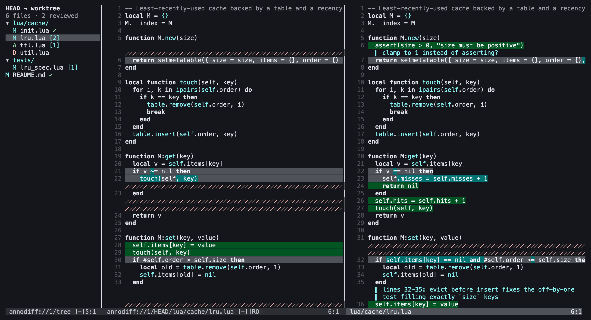
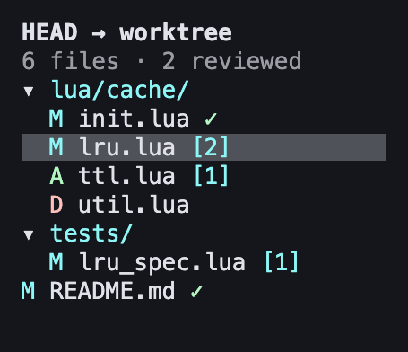
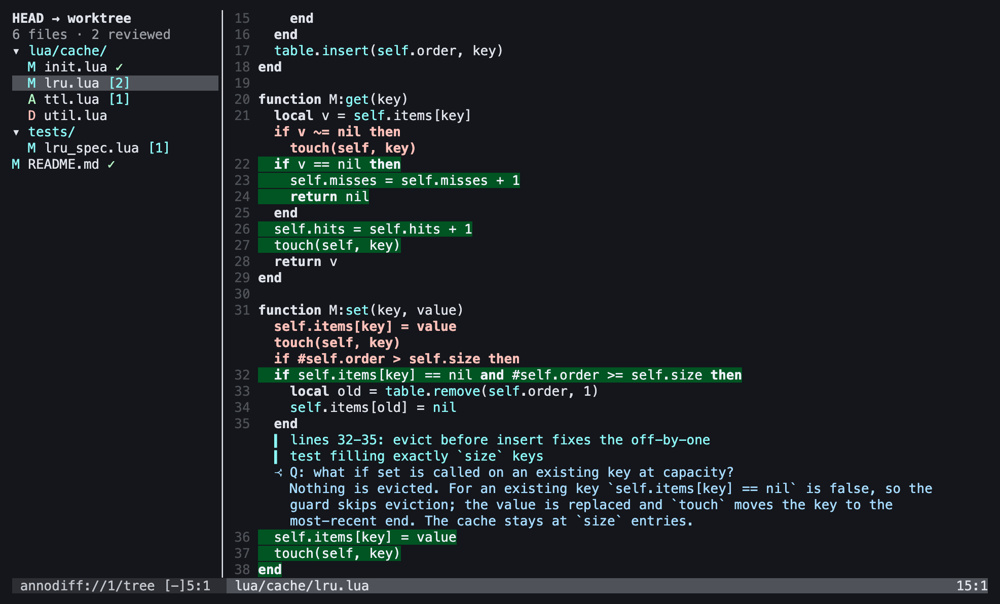
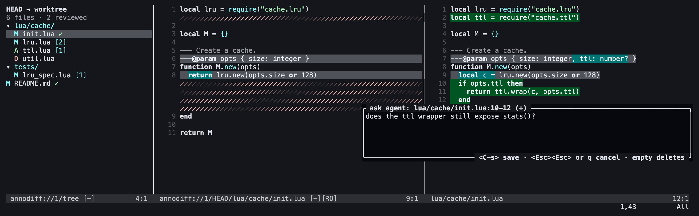
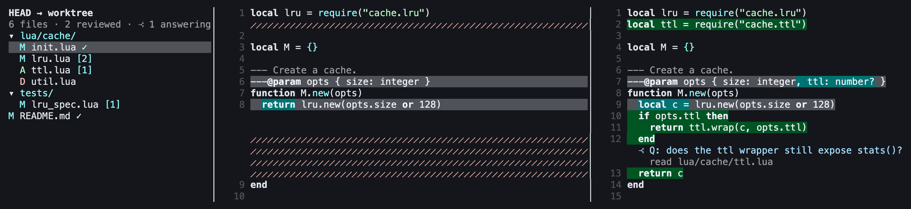
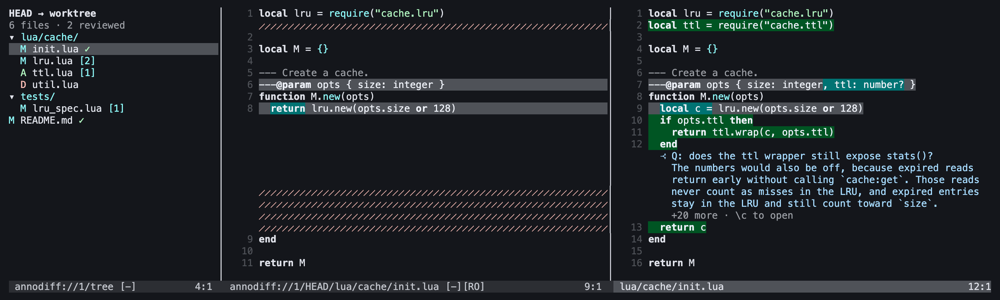
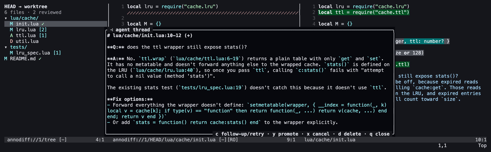

# annodiff.nvim

Review git diffs inside Neovim: a changed-file tree beside native diff windows
(or one inline window), with the worktree side as your real, editable file
(LSP, treesitter, gitsigns all work). Neovim port of [revdiff](https://github.com/andycmaj/revdiff).
Annotate lines, ranges and files; export in revdiff's `##` format so the
revdiff agent skills read it unchanged. Annotations and reviewed marks persist
per review and follow the code when it moves. Send them to an agent, or ask
a read-only agent about a line and read the answer in place (see
[docs/plan.md](docs/plan.md)).



*Split layout: the changed-file tree beside old and new in diff mode, with
annotations drawn under their lines.*

Neovim 0.10+, no dependencies.

## Install

lazy.nvim:

```lua
{ "andycmaj/annodiff.nvim", cmd = { "Annodiff" }, opts = {} }
```

## Use

| Command | Left | Right |
|---|---|---|
| `:Annodiff` | index | worktree |
| `:Annodiff <ref>` | `<ref>` | worktree |
| `:Annodiff --staged [ref]` | `<ref>` (default `HEAD`) | index |
| `:Annodiff A..B` | `A` | `B` |
| `:Annodiff A...B` | merge base of `A` and `B` | `B` |

`:AnnodiffClose`, `:AnnodiffRefresh`, `:AnnodiffExport [path]`, `:AnnodiffSend` and
`:AnnodiffClear[!]` (drop annotations and reviewed marks; `!` skips the prompt)
act on the review in the current tab.
Each review opens in its own tab: `tree | old | new`.



*The tree: git status per file, `✓` for reviewed files, `[N]` annotations.*

### Layouts

- **split** (default): `tree | old | new`, Neovim's diff mode.
- **inline**: `tree | new`. One window with the new side (your real file for
  worktree reviews): added lines highlighted, removed lines drawn as ghost
  rows above the line they were removed before (below the last line when
  removed at the end). A deleted file shows its old content with every line
  marked removed; an added file is all highlighted.

Pick per review with `:Annodiff --inline ...` / `--split`, make inline the
default in your plugin config, or switch any time with `\i` /
`:AnnodiffLayout [inline|split]`:

```lua
-- lazy.nvim
{
  "andycmaj/annodiff.nvim",
  cmd = { "Annodiff", "AnnodiffLayout" },
  opts = { layout = "inline" },
}

-- or without a plugin manager
require("annodiff").setup({ layout = "inline" })
```

In inline, `]c` / `[c` step through the changed rows, and since the cursor
can't sit on a ghost row, `\a`, `\c` and `\d` on a line with ghost rows above
it open a picker: the line itself, each removed line, or the whole removed
block. Notes on removed lines keep their old-side numbers, so the export is
the same in both layouts.



*Inline layout: removed lines as ghost rows above their replacement, a range
annotation, and an agent's answer to `\c` streamed in under the block.*

### Keys

| Key | Where | Action |
|---|---|---|
| `<Tab>` / `<S-Tab>` | everywhere | next / previous file |
| `]c` / `[c` | diff windows | next / previous hunk; past the last / first hunk moves to the next / previous file |
| `<CR>` / `o` | tree | open file, or collapse / expand directory |
| `R` | tree | refresh the file list |
| `q` | tree, read-only buffers | close the review (not mapped on your real file buffers) |
| `<localleader>a` | diff windows (normal / visual) | annotate the line or range; on an annotated line, edit it (save empty to delete) |
| `<localleader>A` | everywhere | file-level annotation |
| `<localleader>d` | diff windows | delete the annotation under the cursor |
| `<localleader>l` | everywhere | pick an annotation (`vim.ui.select`) and jump to it |
| `<localleader>n` / `<localleader>N` | everywhere | next / previous annotation, across files |
| `<Space>` | tree | mark the file under the cursor reviewed (✓) |
| `<localleader>r` | diff windows | mark the open file reviewed |
| `f` / `F` | tree | show only annotated / only unreviewed files (again to clear); `<Tab>` skips hidden files |
| `<localleader>s` / `O` (tree) | everywhere | send the annotations to your agent (see below) |
| `<localleader>c` | diff windows (normal / visual) | ask the agent about the line or range; on a line with a thread, open it |
| `<localleader>C` | everywhere | ask about the whole file, or open its thread |
| `<localleader>i` | everywhere | toggle split / inline layout |

In the annotation float: `<C-s>` (or `<CR>` in normal mode) saves, `q` / `<Esc>`
in normal mode cancels.

## Annotations

Records follow revdiff: `+` added line (new-side number), `-` removed line
(old-side number), ` ` context line (new-side number, from either window),
file-level, and `start-end` ranges. A comment containing the word "hunk" on a
`+` / `-` line widens to the end of that changed block, as in revdiff.

Annotations on your real file follow edits. Each one gets matching blank
virtual lines in the other window so the two sides stay row-aligned.

### Persistence

Each review (`:Annodiff HEAD`, `:Annodiff main...feature`, ...) keeps its
annotations and reviewed marks in `.git/annodiff/reviews/<review>.json`,
written on every change and restored when you open the same review again.
Each annotation stores its line's text; on restore it finds that text again
(same line, else the nearest match), so annotations follow code that moved.
When the text is gone the annotation is kept, drawn where it was, and flagged
"orphaned".

On close, a review with annotations also writes a history entry in revdiff's
format to `$REVDIFF_HISTORY_DIR` or `~/.config/revdiff/history/<repo>/`, so the
revdiff Claude skill's "use my latest revdiff annotations" finds it. Set
`history = false` to turn that off, or `history_dir` to move it.

### Sending to an agent

`:AnnodiffSend` (`\s`, or `O` in the tree) is revdiff's `O` flush with a
post-flush command: the full current set, in revdiff `##` format, goes on
stdin to a shell command, and the same snapshot is written to the export file.
The command comes from `send_command` in `setup()`, then
`$ANNODIFF_SEND_COMMAND`, then revdiff's `$REVDIFF_POST_FLUSH_COMMAND`. With
`send_on_close = true` (or `$ANNODIFF_SEND_ON_CLOSE=1`) closing the review or
quitting Neovim sends the set again if it changed since the last send.

The `/annodiff` Claude Code skill is built on that; see [Claude Code](#claude-code).

### Asking an agent inline

`\c` (or `\C` for the file) asks a headless `claude -p` a question about the
line, range or file. The answer streams in under the line (the last few rows,
with `+N more` when there is more), separate from annotations: questions and
answers are never exported or sent, only written to the history entry as
`## Agent Q&A`. This is a port of the revdiff fork's ask-agent
(`feat/ask-agent`), with the same agent setup:

- read-only: `Read`, `Glob`, `Grep` and an allowlist of read-only `git` / `jj`
  / `hg` commands; edits, web access and config overrides are refused,
  `--permission-mode dontAsk`, user settings only, no MCP servers
- the prompt (file, line, change type, the diff around the line, the review
  scope, your question) goes on stdin, run from the repo root
- each thread forks `$ANNODIFF_AGENT_PARENT_SESSION` (or revdiff's
  `$REVDIFF_AGENT_PARENT_SESSION`, `claude:<id>`) when set, so the agent
  starts with that session's context; the `/annodiff` skill sets it to the
  calling Claude session
- stalls show `no output for Ns`; after 5 silent minutes the agent is stopped



*Select lines 10-12 and press `\c`. The float's title names the range; type
the question and press `<C-s>`.*



*While it works, the row under the question shows what the agent is doing and
the tree header counts `⟢ 1 answering`.*



*The answer's last rows stay under the range; `+N more` points to the full
thread.*

`\c` on a line that has a thread opens it in a window: `c` follow-up (resumes
the thread's session) or retry after a failure, `y` promote the answer to an
annotation (an existing annotation there is kept above it), `x` cancel, `d`
delete, `q` close. The tree header shows `⟢ N answering` while answers stream.
Threads live for the review; refresh drops threads whose file left it.



*`\c` on the line again opens the whole thread, with follow-up, promote,
cancel and delete keys.*

The question and that context go to the `claude` CLI; annodiff sends nothing
anywhere itself. Turn the feature off with `agent = false`.

### Export

`:AnnodiffExport [path]` writes them (atomic, mode 0600); the default path is
`.git/annodiff/annotations.md`, and closing a review with annotations writes
there too. The output is byte-identical to what revdiff's own `FormatOutput`
produces for the same records.

Revision and index sides are read-only scratch buffers. Added and deleted files
show an empty side; binary files show a placeholder.

## Claude Code

A Claude Code plugin marketplace, mirroring revdiff's: a review skill (`annodiff`) and
an optional plan-review hook (`annodiff-planning`). Needs tmux, Neovim 0.10+ and git;
the hook also needs python3.

```text
/plugin marketplace add andycmaj/annodiff.nvim
/plugin install annodiff@annodiff
/plugin install annodiff-planning@annodiff   # optional: review plans before they run
```

From a checkout: `claude --plugin-dir /path/to/annodiff.nvim` (and
`--plugin-dir /path/to/annodiff.nvim/plugins/annodiff-planning`), or link the skill:
`ln -s "$PWD/skills/annodiff" ~/.claude/skills/annodiff`.

### `/annodiff` (review skill)

`/annodiff:annodiff [annodiff args]` opens `:Annodiff` beside the Claude pane (a zoomed
split in a Riker task window, otherwise a new tmux window) and returns at once. Notes you
send with `\s` (or `O` in the tree, or by closing the review) are pasted into the Claude
session; Claude answers questions (`??`, explain/what/how/why) and makes the rest as
changes, which you see live on the worktree side. With no args the review is picked like
revdiff's `detect-ref.sh`: on main, uncommitted changes (`HEAD`) or the last commit
(`HEAD~1`); on a clean feature branch, the merge base vs the worktree; on a dirty feature
branch Claude asks which. "Use my latest annodiff annotations" reads the newest of
`.git/annodiff/annotations.md` and this checkout's history entries. An executable
`$CLAUDE_PLUGIN_DATA/scripts/open.sh` replaces the bundled launcher.

### Plan review (`annodiff-planning`)

A `PreToolUse` hook on `ExitPlanMode`. Each session gets a plan repo
(`$TMPDIR/annodiff-plan-<session>/`) whose HEAD is the previous revision of `plan.md`; the
review is `:Annodiff HEAD`, blocking until you quit Neovim. The first round shows the whole
plan, later rounds only what changed. Annotations, and any edits you make to `plan.md`,
go back as the denial reason and Claude revises the plan; quitting without notes gives
Claude Code's normal plan prompt. Failures (no tmux, no nvim) fail open. Override the
launcher with an executable `$CLAUDE_PLUGIN_DATA/scripts/launch-plan-review.sh` (same
contract as revdiff's: annotations on stdout, exit 10 when there are any).

### Differences from revdiff's plugin

- The review does not block Claude: notes are pushed into the session as they are sent
  (revdiff's skill waits on the TUI and reads its stdout). Claude makes changes directly
  instead of entering plan mode, since the worktree side shows them live.
- Plan rounds are chained by the session id, not by a marker the agent has to copy into
  its next plan, and no agent-supplied path is read.
- tmux only (revdiff also drives zellij, kitty, wezterm, ghostty, iTerm2 and others).
- No file-only (`--only`), all-files, `--stdin` patch or `--annotations` preload modes,
  and no explanation loop: annodiff reviews git diffs, and `\c` answers questions in place.
  For a PR, `gh pr checkout N` and review `base...HEAD`.
- Codex, opencode and pi plugins are not ported.

## Config

```lua
require("annodiff").setup({
  tree_width = 35,
  layout = "split", -- or "inline"
  history = true, -- revdiff-format history entry on close
  history_dir = nil, -- default $REVDIFF_HISTORY_DIR or ~/.config/revdiff/history
  send_command = nil, -- sh -c; annotations on stdin
  send_on_close = false,
  agent = { -- false turns inline questions off
    binary = "claude",
    model = nil, -- e.g. "haiku"
    args = {}, -- extra CLI arguments, appended last
    system_prompt = nil, -- replaces the default answer guidance
  },
  keymaps = {
    next_file = "<Tab>",
    prev_file = "<S-Tab>",
    next_hunk = "]c",
    prev_hunk = "[c",
    select = { "<CR>", "o" },
    refresh = "R",
    close = "q",
    annotate = "<localleader>a",
    annotate_file = "<localleader>A",
    delete_annotation = "<localleader>d",
    list_annotations = "<localleader>l",
    next_annotation = "<localleader>n",
    prev_annotation = "<localleader>N",
    toggle_reviewed = "<localleader>r",
    tree_toggle_reviewed = "<Space>",
    filter_annotated = "f",
    filter_unreviewed = "F",
    send = "<localleader>s",
    tree_send = "O",
    ask = "<localleader>c",
    ask_file = "<localleader>C",
    toggle_layout = "<localleader>i",
  },
})
```

Set any key to `false` to disable it.

## Tests

```sh
make test   # nvim --clean --headless -l tests/run.lua
```

The end-to-end tests build throwaway git repos and drive the real UI headless.
